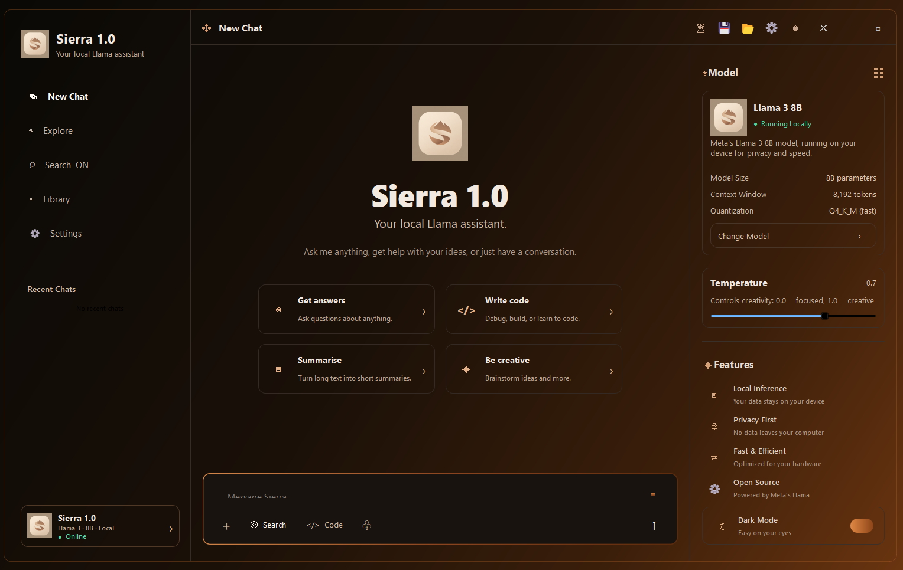
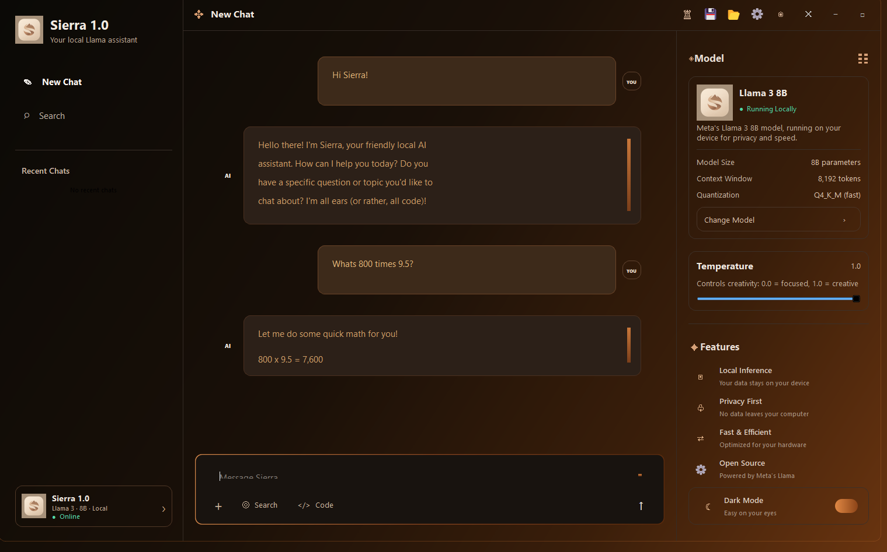
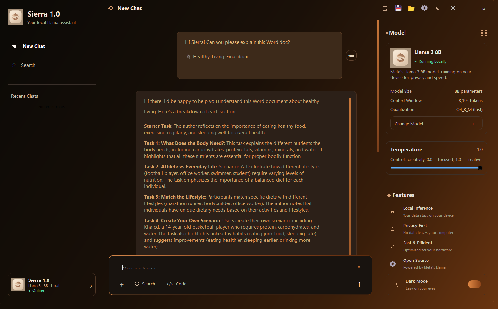

# Vanta AI — Local AI Assistant (Beta)

> A beautiful, ChatGPT-style local AI chat app powered by Llama 3. Runs entirely on your computer. No API keys. No cloud. 100% private.



---

## ✨ Features (v1.2.0 Massive Overhaul)

- 🤖 **Local AI & Dual Modes** — Switch seamlessly between **Sierra** (conversational research assistant) and **Luna** (autonomous coding engineer)
- 🚀 **Luna Autonomous Coding Agent** — Claude- & Cursor-level agent that inspects, creates, surgically edits, tests, and validates code directly inside your workspace
- 🛠️ **18 Autonomous Coding Tools**:
  - `write_file`, `edit_file`, `patch_file`, `append_file`: Targeted surgical & block-based code writing
  - `read_file`, `list_dir`, `get_file_info`: Deep workspace exploration and metadata inspection
  - `create_dir`, `rename_file`, `delete_file`: Full file & directory lifecycle management
  - `search_code`, `grep`: Literal and regex-based codebase search with glob filters
  - `check_syntax`: Pre-flight AST validation for Python, JS/TS, HTML, CSS, and JSON
  - `get_file_outline`: Fast structural symbol outline (classes, functions, IDs) for navigating large files
  - `undo_last_edit`: Instant rollback to the previous snapshot if an edit or test fails
  - `run_command`: PowerShell execution with real-time output and timeout protection
  - `scaffold_project`, `open_browser`: Instant template generator and live browser preview
- 📁 **Active Workspace Management** — Select any local folder; includes a live workspace file explorer in the sidebar that auto-syncs with disk changes
- 🛡️ **Interactive Safety & Auto-Run** — Toggle between **⚡ Auto-Run: ON** (full autonomous speed) and **⏸ Auto-Run: OFF** (interactive approval cards with diff previews)
- 💬 **Claude-Style Message Action Bar** — One-click **Copy Response** to markdown and **Regenerate** to easily iterate on AI outputs
- ⚡ **Streaming Responses** — Low-latency streaming with live markdown rendering and syntax highlighting
- 📎 **File Attachments** — Attach Word docs, PDFs, code files, CSVs, and more
- 💾 **Auto-Save & History** — Conversations auto-save locally with quick access in Recent Chats
- 🎨 **Dual Themes** — Warm Sierra desert amber & deep Luna starfield navy with smooth animated transitions

---

## 📸 Screenshots

### Welcome Screen


### Chat


### File Attachments


---

## 🚀 Quick Start

### Prerequisites

1. **Python 3.9+**
2. **Ollama** — [Download here](https://ollama.com/download)

### 1. Install Ollama & pull the model

```bash
ollama pull llama3
```

### 2. Clone & set up Vanta AI

```bash
git clone https://github.com/Delta3211/vanta-ai.git
cd vanta-ai
python -m venv venv
venv\Scripts\activate
pip install -r requirements.txt
```

### 3. Run

```bash
python main.py
```

Or double-click **`run.bat`** on Windows.

---

## 🎯 Usage

| Action | How |
|---|---|
| Send a message | Type and press `Enter` |
| New line in input | `Shift+Enter` |
| Attach a file | Click **+** in the composer |
| Toggle web search | Click **Search** in the sidebar or composer |
| Save chat manually | Click 💾 in the title bar |
| Load a past chat | Click 📂 or pick from Recent Chats |
| New conversation | Click **New Chat** |

### Supported File Types for Attachment
`.txt` `.md` `.pdf` `.docx` `.py` `.js` `.ts` `.html` `.css` `.json` `.xml` `.yaml` `.csv` `.c` `.cpp` `.java` `.cs` `.go` and more

---

## ⚙️ Customization

### Change the model

Edit `main.py` line ~65:

```python
MODEL_NAME = "llama3"  # swap for mistral, gemma2, phi3, etc.
```

### Change the theme

All styling lives in the `_stylesheet()` method and the `paintEvent` of `LocalAIApp`. The palette is built around warm desert ambers.

---

## 🛠️ Project Structure

```
vanta-ai/
├── main.py              # Main application window, theme engine, and chat interface
├── agent.py             # Luna autonomous agent execution loop and tool dispatch
├── agent_ui.py          # Glowing tool cards, workspace bar, and file tree widgets
├── workspace.py         # File manager: surgical editing, syntax checking, undo stack
├── Modelfile.luna       # Custom Ollama model definition for Luna 1.1
├── requirements.txt     # Python dependencies
├── run.bat              # Windows one-click launcher
├── CHANGELOG.md         # Full release history and notes
├── assets/
│   ├── sierra-desert-icon.png
│   ├── screenshot-welcome.png
│   ├── screenshot-chat.png
│   └── screenshot-attachment.png
└── .sierra/             # Local workspace configuration and chat storage
```

---

## 📦 Requirements

| Requirement | Minimum |
|---|---|
| OS | Windows 10/11 |
| Python | 3.9+ |
| RAM | 8 GB (16 GB recommended) |
| GPU | NVIDIA recommended (CUDA), CPU works too |
| Storage | 5 GB+ for models |

---

## 🐛 Troubleshooting

**"Ollama not running" error**
```bash
ollama serve
```

**Model not found**
```bash
ollama pull llama3
```

**Import errors**
```bash
venv\Scripts\activate
pip install -r requirements.txt
```

---

## ⚠️ Beta Notice

This is a **beta release**. Expect rough edges. Issues and PRs are welcome.

---

## 📄 License

MIT — see [LICENSE](LICENSE)

---

*Powered by [Ollama](https://ollama.com) · [LangChain](https://langchain.com) · [Meta Llama 3](https://llama.meta.com)*
